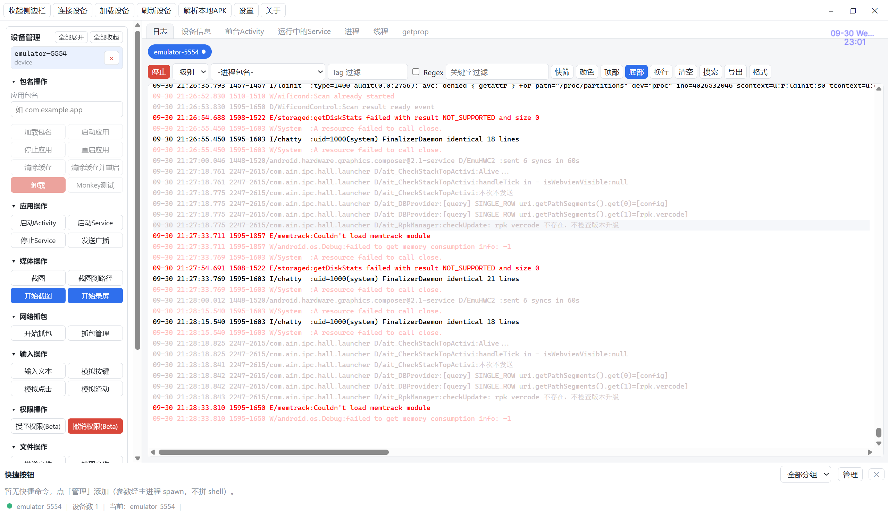

# ADB++

Windows 平台的工程级 ADB 桌面工具。Electron 37 + Vue 3，专注日志分析与设备调试，所有 adb/aapt 子进程统一收口在主进程。



参考：Android Studio Logcat / Android Turbo Tools / SecureCRT / Notepad++ / WorkBuddy。

## 功能一览

### 日志（类 Android Studio Logcat）

- 多设备并行：按设备分 tab 与独立采集状态，日志按设备分文件自动写盘。
- 实时流式采集，级别（V/D/I/W/E/F）、Tag、关键字、正则、包名过滤；Tag 全词匹配、按包名一次选中该 APK 的全部进程。
- Tag / 关键字过滤历史，可锁定条目（锁定项不被裁剪/清空）；按 Tag 快速筛选（自动生成正则）。
- 日志级别颜色（文本/背景/加粗）+ 按内容关键字上色（全局规则 + 会话规则，会话优先）；显示格式可配日期 / pid / 包名 / Tag。
- 查找（Ctrl+F，浮动非遮挡窗口）、换行开关、导出 `.log`、自动保存到磁盘。
- 日志内可回车插入注释行；单击定位光标（折叠选区），方向键移动光标、Ctrl+↑/↓ 逐行滚窗、Ctrl+←/→ 按词移动，行为可在「设置 - 窗口属性」切换。
- 渲染策略：全量缓存在内存，过滤后只取尾部 `maxRender`（默认 20000）行交给 Vue，避免 DOM 爆炸。

### 设备信息与检测

- 信息卡：型号、Android 版本、分辨率、密度、内存、存储、CPU、android_id、stbid、oid、多网卡 MAC、前台 Activity；可导出。
- `dumpsys <service>` 查询、`bugreport`、`getprop` 列表（过滤 + 导出）。
- 四个轮询列表：前台 Activity / 运行中 Service / 进程（PID、CPU、RSS、VSZ、线程、状态、IO）/ 线程，各自独立开关、间隔、过滤与手动刷新。

### 设备操作（侧边栏分组）

- 包名操作：加载包名、启动/停止/重启应用、停止进程、清缓存、清缓存并重启、卸载、Monkey 测试。
- 组件调试：启动 Activity / Service、发送广播、停止 Service。
- 媒体：截图、截图到路径、连续截图（间隔可配）、录屏。
- 网络抓包：设备端 `tcpdump` 常驻，停止时 `pkill -INT` 刷盘，按需 pull / 列表 / 删除 pcap；支持 `su -c` 仅给 tcpdump 提权；抓包管理弹窗统一操作。
- 输入：输入文本、模拟按键（含 KEYCODE 速查表）、模拟点击、模拟滑动；动作可保存为快捷按钮。
- 权限授予/撤销（Beta）、推送/拉取文件、安装/卸载 APK、解析已装 APK、root/unroot/remount、重启、`adb devices` / `disconnect` / `kill-server`。

### 其他

- **APK 解析**：本地 APK 与设备已装包两条路，`aapt dump badging` 输出包名、版本、label、启动 Activity、权限列表和 MD5；中文路径自动走临时 ASCII 副本规避 aapt 编码问题。
- **快捷命令**：按分组筛选，增删改、颜色预设、忽略响应、执行输出（复制/保存）；支持开机式持久化到配置。
- **自定义窗口**：无原生标题栏（自绘菜单栏），置顶（图钉按钮，主进程读真实状态翻转）、最小化/最大化/关闭；Ctrl+/-/0 与 Ctrl+滚轮缩放（0.3~3）；顶部设备时钟点击激活后同步设备时间（10 秒校准，重启复位）。
- **设置面板 10 页**：通用（maxRender、光标行为、启动检测升级、配置路径、设置导入导出）、窗口属性、程序日志路径、日志字体（系统字体下拉）、日志级别颜色、日志内容颜色、日志自动保存、历史过滤设置、抓包设置、截图设置。
- **版本检测**：启动 30 秒后异步检测一次（可关），关于弹窗手动检测；有新版本时状态栏徽标 + 升级对话框，可「本日不再提醒」。数据源为 GitHub Releases，失败回退读仓库 `package.json`。

## 目录结构

```
AdbPlusPlus/
├─ main/                      主进程（ESM）：窗口、IPC 注册、子进程调用
│  ├─ index.js                入口：窗口创建 + 各模块注册 + 更新检测 + 退出清理
│  ├─ preload.js              安全桥 window.api（invoke/send/on 三通道白名单）
│  ├─ adb.js / adb-safety.js  adb 命令与设备端参数白名单
│  ├─ logcat.js / logcat-ingest.js  日志采集、跨 chunk 行合并与推送
│  ├─ netcap.js / netcap-safety.js  设备端 tcpdump 抓包与参数白名单
│  ├─ media.js / apk.js / file.js / config.js / fonts.js / applog.js
│  ├─ devices.js              设备热插拔跟踪
│  ├─ tools.js                adb/aapt 路径解析与 spawn 封装
│  ├─ versioncheck.js         版本检测（GitHub Releases / raw package.json）
│  └─ device-scripts/         设备端 shell 脚本
├─ shared/                    主/渲染共用：ipc-channels.js（通道常量 + 白名单）、version.js
├─ src/                       渲染进程（Vue 3）
│  ├─ App.vue                 根组件（布局 + 弹窗装配）
│  ├─ components/             5 个非模态组件 + modals/（23 个弹窗）
│  ├─ composables/            state.js 桶文件 + state/ 11 个域模块 + shared.js 纯函数
│  │                          + useXxx.js 行为层（12 个）+ createPollingList.js
│  └─ styles.css              全局样式
├─ tests/                     5 组 node:test 单测（安全白名单 / 日志 ingest / 轮询 / 纯函数）
├─ scripts/                   dev.js 开发启动器；check.mjs 静态验证管线
├─ resources/                 adb.exe / aapt.exe / icon.png / alipay.jpg（二进制已入库）
├─ adbtool-config.sample.json 配置样例（真实配置 adbtool-config.json 不入库）
├─ docs/                      本地文档（已由 .gitignore 排除，不入库）
├─ index.html / vite.config.js / electron-builder.yml / jsconfig.json / package.json
└─ LICENSE
```

## 前置

- 仅 Windows。开发机用 Node.js 22.x（跑 Vite / 打包脚本）；运行时由 Electron 37 提供 Chromium 138 + Node 22。
- `resources/adb.exe`、`resources/aapt.exe` 已随仓库提供；升级版本时直接替换这两个文件。开发态从 `app.getAppPath()/resources` 解析，打包态从 `process.resourcesPath/resources` 解析。
- 内网 / GitHub 不可达时，安装依赖与打包前设置镜像：

```bash
export ELECTRON_MIRROR=https://npmmirror.com/mirrors/electron/
export ELECTRON_BUILDER_BINARIES_MIRROR=https://npmmirror.com/mirrors/electron-builder-binaries/
npm install
```

## 开发

```bash
npm run dev          # Vite(5173, strictPort) + Electron；端口被占会直接失败，先释放 5173
npm run check        # 静态验证：tsc checkJs / 通道常量与白名单 / 无环 / barrel 完整 / 模板绑定
npm test             # 单测：安全白名单(logcat/netcap/adb) / 轮询工厂 / 纯函数
```

- `scripts/dev.js` 只启动一次主进程，**不监听 main/ 目录、不自动重启**。改了 `main/` 或 `shared/` 后必须完全退出 `npm run dev` 再重跑，否则渲染层是新代码、主进程仍是旧代码。
- Vite 开发用 `base:'/'`，打包用 `base:'./'`（Electron 以 `file://` 加载 dist）。

## 打包

三条命令都先 `vite build` 写入 `dist/`，再由 electron-builder 打包；产物目录由 `electron-builder.yml` 的 `directories.output: release` 决定。

| 命令 | 等价命令 | 产物 |
|------|----------|------|
| `npm run build` | `vite build && electron-builder --win nsis` | 安装版 `release/*.exe` |
| `npm run dist`  | 同上 | 安装版，同 build |
| `npm run pack`  | `vite build && electron-builder --win dir` | 绿色版目录 `release/win-unpacked/`，拷贝整目录后双击 `adb++.exe` 即可 |

NSIS 配置为非一键安装，允许选安装目录并创建桌面快捷方式。

## 配置

- 默认 `adbtool-config.json` 放在 exe 所在目录（开发态为工程根），便于整体拷贝；可通过设置面板指定完整文件路径，路径指针存于 `userData/adbtool-path.json`，规避 `C:\Program Files` 写权限问题。
- 启动加载时把默认值与磁盘 JSON 合并；保存时**只写 DEFAULT 登记的键**，外部导入的未知字段直接丢弃（防止进入设备端命令）；写入走同目录临时文件 + rename 的原子替换。
- 字段说明见 `adbtool-config.sample.json`，含快捷命令、过滤条件、日志字体/颜色、抓包与截图参数、`maxRender`、更新开关等。

## 安全要点

- 本机子进程一律在主进程用参数数组 `spawn(tool, [args...])`，不拼本机 shell。但 adbd 收到 `adb shell` 参数后仍会拼成串交给设备端 `/system/bin/sh -c`，因此用户可控参数另过白名单或转成 shell 字面量：`main/adb-safety.js`、`main/netcap-safety.js`，调用点见 `main/adb.js`、`main/netcap.js`。这些边界有专门单测覆盖注入串。
- 渲染进程 `nodeIntegration:false` + `contextIsolation:true`，只能经 preload 的 `window.api` 通信；invoke / send / on 三类通道各有白名单，未登记通道直接拒绝。通道常量定义在 `shared/ipc-channels.js`，是三方共用的单一事实来源。
- 配置保存有键白名单；抓包参数会剔除用户传入的 `-w` 路径值，输出路径由程序生成的规则文件名接管。
- 应用版本以 `package.json` semver 为准（`app.getVersion()`），关于弹窗运行时读取，不硬编码。
- 进程 `before-quit` 统一收掉设备端 tcpdump、logcat 与设备跟踪，带 3 秒兜底超时，避免退出挂死。

## 已知限制

- 日志为全量内存缓冲 + 尾部截取渲染。日志极快时可加大 `maxRender`，或考虑虚拟列表。
- 录屏依赖设备 `screenrecord`：单段最长 180 秒、不采音频、DRM 保护内容录出来是黑屏；更长时间需分段录制 + ffmpeg 拼接（当前未内置 ffmpeg）。
- 抓包要求设备已预装 `tcpdump`；`su -c` 提权模式还要求设备已 root 且存在 `su`。
- 权限授予/撤销、清除设备缓存仍标注 Beta。
- 多版本 adb 共存（如模拟器自带 adb）会互相重启 server，表现为日志/进程间歇无数据且无报错；统一版本或 `adb kill-server` 可解。
- 版本检测只提示、不自动下载安装；GitHub 不可达时回退读 raw `package.json`，仍失败则静默跳过。

## 语言包测试（开发模式）

外部语言包从 `adbtool-config.json` 所在目录扫描（开发态 = 工程根），识别 `*.xml` 与 `*.lang.json`。工程根已内嵌 7 种语言包：

| 文件 | 语言 | 覆盖 |
|---|---|---|
| `ja-JP.xml` | 日本語 | **完整版**，620 条（全部界面词条） |
| `zh-TW.xml` | 繁體中文 | 核心词条 65 条 |
| `ko-KR.xml` | 한국어 | 核心词条 71 条 |
| `fr-FR.xml` | Français | 核心词条 68 条 |
| `es-ES.xml` | Español | 核心词条 68 条 |
| `ur-PK.xml` | اردو | 核心词条 67 条 |
| `ru-RU.xml` | Русский | 核心词条 122 条 |

未翻译词条按各自 `fallback` 回退。`KEYCODE` 描述不在这 7 个包里，走内置英文（可用设置里的「KEYCODE 描述语言」切换）。`templates/lang/` 下另有可扩展的样例模板。

- 立即测试：在设置 → 语言包 → 界面语言选「日本語（示例）」，或把 `adbtool-config.json` 的 `"lang"` 改为 `"ja-JP"` 后重启。
- 复制其它样例：`npm run lang:sample -- zh-TW`（目标已存在需加 `--force`），然后同上切换。
- 改完语言包文件不用重启：设置 → 语言包 → 重新加载语言包。
- `lang` 留空即跟随系统：`app.getLocale()` 以 `zh` 开头选简体中文，否则选英文；探测结果不写回配置。外部语言包（如 ja-JP）需显式指定，不参与自动探测。
- 只需翻译部分词条，其余按 `<resources fallback="...">` → 内置语言逐级回退。
- 导出全量模板：设置 → 语言包 → 导出语言模板。`locale` 留空的文件会被当作模板跳过，不会覆盖当前语言。
- 安全边界：解析器禁止 DOCTYPE/ENTITY；单文件 ≤256KB、最多 64 个文件、单值 ≤2000 字符。非法词条丢弃并在设置面板列出告警。
