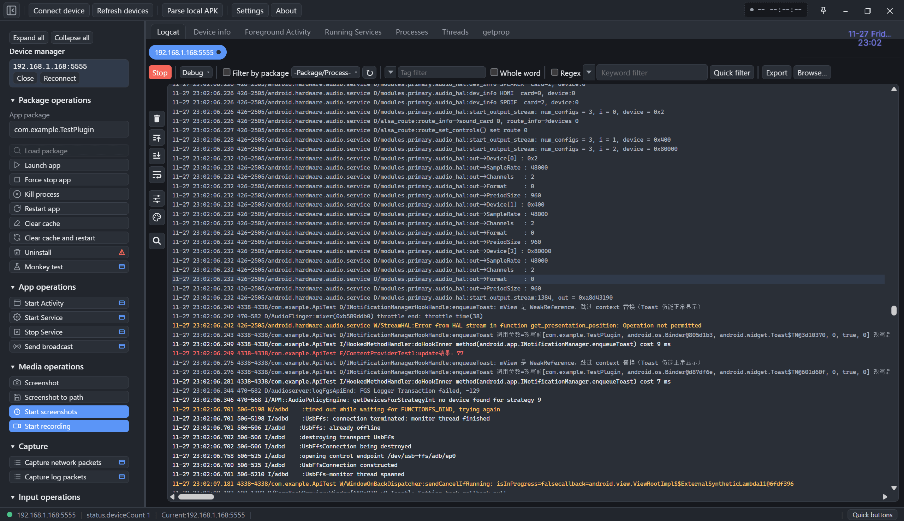
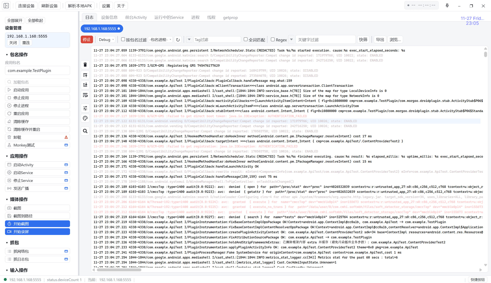
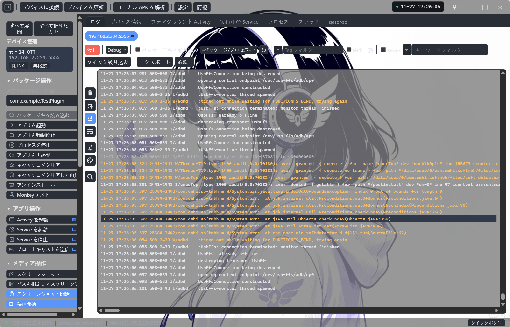

# ADB++







> **语言 / Language**: [English](#en-US) · [简体中文](#zh-CN) · [繁體中文](#zh-TW) · [日本語](#ja-JP) · [한국어](#ko-KR) · [Français](#fr-FR) · [Español](#es-ES) · [Русский](#ru-RU) · [اردو](#ur-PK)

<a id="en-US"></a>

## English

An engineering-grade ADB desktop tool for Windows. Built with Electron 37 + Vue 3, focused on log analysis and device debugging, with all adb/aapt child processes centralized in the main process.

References: Android Studio Logcat / Android Turbo Tools / SecureCRT / Notepad++ / WorkBuddy.

### Logs (Android Studio Logcat style)

- Multi-device in parallel: per-device tabs with independent collection state; logs are auto-saved to disk in a separate file per device.
- Real-time streaming collection with filtering by level (V/D/I/W/E/F), Tag, keyword, regex, and package name; whole-word Tag matching; select all processes of an APK at once by package name.
- Tag / keyword filter history with lockable entries (locked entries are never trimmed or cleared); quick Tag filtering (auto-generates a regex).
- Log level colors (text / background / bold) plus coloring by content keyword (global rules + session rules, session takes precedence); configurable display format for date / pid / package name / Tag.
- Find (Ctrl+F, floating non-obstructive window), word-wrap toggle, export to `.log`, and auto-save to disk.
- Press Enter inside the log to insert a note line; a single click places the caret (collapsed selection), arrow keys move the caret, Ctrl+↑/↓ scrolls line by line, Ctrl+←/→ moves by word; behavior can be toggled in Settings - Window.
- Rendering strategy: the full log is cached in memory; only the last `maxRender` filtered lines are handed to Vue (default 3000, hard cap 3000), avoiding DOM explosion.
- Wheel control: vertical wheel speed is configurable (0.25~99, 1.0 by default); scrolling down once at the log end re-locks bottom follow, scrolling up still cancels follow.

### Device info & diagnostics

- Info card: model, Android version, resolution, density, memory, storage, CPU, android_id, stbid, oid, multi-NIC MAC, foreground Activity; exportable.
- `dumpsys <service>` query, `bugreport`, `getprop` list (filter + export).
- Four polling lists: foreground Activity / running Services / processes (PID, CPU, RSS, VSZ, threads, state, IO) / threads, each with its own switch, interval, filter, and manual refresh.

### Device operations (sidebar groups)

- Package operations: load package, launch/stop/restart app, stop process, clear cache, clear cache and restart, uninstall, Monkey test.
- Component debugging: start Activity / Service, send broadcast, stop Service.
- Media: screenshot, screenshot to path, continuous screenshots (configurable interval), screen recording.
- Network capture: `tcpdump` stays resident on the device, stop flushes via exact-PID `kill -INT` (`pkill -INT` only as fallback), pull / list / delete pcap on demand; supports `su -c` to elevate only tcpdump; unified operations in the capture manager dialog.
- Input: input text, send keys (with KEYCODE reference table), tap, swipe; actions can be saved as quick buttons.
- Grant/revoke permissions (Beta), push/pull files, install/uninstall APK, parse installed APK, root/unroot/remount, reboot, `adb devices` / `disconnect` / `kill-server`.

### Others

- **APK parsing**: two paths — local APK and installed packages on the device; `aapt dump badging` outputs package name, version, label, launch Activity, permission list, and MD5; Chinese paths automatically use a temporary ASCII copy to work around aapt encoding issues.
- **Quick commands**: filter by group, add/edit/delete, color presets, ignore response, execution output (copy/save); persistent to config across restarts.
- **Custom window**: no native title bar (self-drawn menu bar), always-on-top (pin button; main process reads the real state before toggling), minimize/maximize/close; Ctrl+/-/0 and Ctrl+scroll to zoom (0.3~3); click the device clock at the top to activate time sync (calibrated every 10s, reset on restart).
- **Theme & background**: system / light / dark theme (default follows system); custom background image (PNG/JPG/WebP, ≤10MB, scaled to 1920px longest edge); log area and non-log area (menu / sidebar / quick bar / status bar) have independent color and transparency.
- **Sidebar resize**: drag its right edge to change width (160~480px), saved to config automatically.
- **Offline log**: device-side background `logcat` writes to disk; stop / list / download to local on demand; configurable logcat args, device and local directories, and `su -c` elevation for logcat only.
- **Auto-reconnect**: unexpected disconnects of network devices retry automatically at a configurable interval (1~3600 seconds, 5 by default); manual close / disconnect / cancel is never retried, USB devices require replugging.
- **Settings panel (13 pages)**: General (theme, maxRender, caret behavior, startup update check, auto-reconnect, config path, import/export settings), language pack, Window (incl. custom background), app log path, log font, log scrolling (wheel speed 0.25~99, wheel-down lock at log end), log level colors, log content colors, log auto-save, filter history, capture, offline log, screenshot settings.
- **Update check**: one async check 30s after startup (can be disabled), manual check in the About dialog; when a new version is available, a status bar badge + upgrade dialog appear, with a "don't remind today" option. Data source is GitHub Releases, falling back to the repo's `package.json` on failure.

<a id="zh-CN"></a>

## 简体中文

Windows 平台的工程级 ADB 桌面工具。Electron 37 + Vue 3，专注日志分析与设备调试，所有 adb/aapt 子进程统一收口在主进程。

参考：Android Studio Logcat / Android Turbo Tools / SecureCRT / Notepad++ / WorkBuddy。


### 日志（类 Android Studio Logcat）

- 多设备并行：按设备分 tab 与独立采集状态，日志按设备分文件自动写盘。
- 实时流式采集，级别（V/D/I/W/E/F）、Tag、关键字、正则、包名过滤；Tag 全词匹配、按包名一次选中该 APK 的全部进程。
- Tag / 关键字过滤历史，可锁定条目（锁定项不被裁剪/清空）；按 Tag 快速筛选（自动生成正则）。
- 日志级别颜色（文本/背景/加粗）+ 按内容关键字上色（全局规则 + 会话规则，会话优先）；显示格式可配日期 / pid / 包名 / Tag。
- 查找（Ctrl+F，浮动非遮挡窗口）、换行开关、导出 `.log`、自动保存到磁盘。
- 日志内可回车插入注释行；单击定位光标（折叠选区），方向键移动光标、Ctrl+↑/↓ 逐行滚窗、Ctrl+←/→ 按词移动，行为可在「设置 - 窗口属性」切换。
- 渲染策略：全量缓存在内存，过滤后只取尾部 `maxRender` 行交给 Vue（默认 3000，硬上限 3000），避免 DOM 爆炸。
- 滚轮控制：日志区竖向滚轮速度可调（0.25~99 倍，默认 1.0）；贴底后再向下滚一下重新锁定底部跟随，上滚仍会取消跟随。

### 设备信息与检测

- 信息卡：型号、Android 版本、分辨率、密度、内存、存储、CPU、android_id、stbid、oid、多网卡 MAC、前台 Activity；可导出。
- `dumpsys <service>` 查询、`bugreport`、`getprop` 列表（过滤 + 导出）。
- 四个轮询列表：前台 Activity / 运行中 Service / 进程（PID、CPU、RSS、VSZ、线程、状态、IO）/ 线程，各自独立开关、间隔、过滤与手动刷新。

### 设备操作（侧边栏分组）

- 包名操作：加载包名、启动/停止/重启应用、停止进程、清缓存、清缓存并重启、卸载、Monkey 测试。
- 组件调试：启动 Activity / Service、发送广播、停止 Service。
- 媒体：截图、截图到路径、连续截图（间隔可配）、录屏。
- 网络抓包：设备端 `tcpdump` 常驻，停止时按 PID 精确 `kill -INT` 刷盘（PID 丢失才用 `pkill -INT` 兜底），按需 pull / 列表 / 删除 pcap；支持 `su -c` 仅给 tcpdump 提权；抓包管理弹窗统一操作。
- 输入：输入文本、模拟按键（含 KEYCODE 速查表）、模拟点击、模拟滑动；动作可保存为快捷按钮。
- 权限授予/撤销（Beta）、推送/拉取文件、安装/卸载 APK、解析已装 APK、root/unroot/remount、重启、`adb devices` / `disconnect` / `kill-server`。

### 其他

- **APK 解析**：本地 APK 与设备已装包两条路，`aapt dump badging` 输出包名、版本、label、启动 Activity、权限列表和 MD5；中文路径自动走临时 ASCII 副本规避 aapt 编码问题。
- **快捷命令**：按分组筛选，增删改、颜色预设、忽略响应、执行输出（复制/保存）；支持开机式持久化到配置。
- **自定义窗口**：无原生标题栏（自绘菜单栏），置顶（图钉按钮，主进程读真实状态翻转）、最小化/最大化/关闭；Ctrl+/-/0 与 Ctrl+滚轮缩放（0.3~3）；顶部设备时钟点击激活后同步设备时间（10 秒校准，重启复位）。
- **界面主题与背景**：跟随系统 / 浅色 / 深色三态主题（默认跟随系统）；自定义背景图（PNG/JPG/WebP，≤10MB，等比缩放至最长边 1920px）；日志区与非日志区（菜单栏 / 侧栏 / 快捷栏 / 状态栏）可分别设置背景色和透明度。
- **侧栏调宽**：拖动侧栏右缘改宽度（160~480px），自动保存到配置。
- **离线日志**：设备端后台 `logcat` 落盘，按需停止、列表、下载到本地；logcat 参数、设备端与本地目录可配，支持 `su -c` 仅给 logcat 提权。
- **断线自动重连**：网络设备意外断线后按可配间隔（1~3600 秒，默认 5 秒）自动重试；手动关闭、断开、取消连接不会重连，USB 设备需重新插拔。
- **设置面板 13 页**：通用（主题、maxRender、光标行为、启动检测升级、断线自动重连、配置路径、设置导入导出）、语言包、窗口属性（含自定义背景）、程序日志路径、日志字体、日志滚动（滚轮速度 0.25~99、贴底下滚锁定）、日志级别颜色、日志内容颜色、日志自动保存、历史过滤设置、抓包设置、离线日志设置、截图设置。
- **版本检测**：启动 30 秒后异步检测一次（可关），关于弹窗手动检测；有新版本时状态栏徽标 + 升级对话框，可「本日不再提醒」。数据源为 GitHub Releases，失败回退读仓库 `package.json`。

<a id="zh-TW"></a>

## 繁體中文

Windows 平台的工程級 ADB 桌面工具。Electron 37 + Vue 3，專注日誌分析與裝置除錯，所有 adb/aapt 子處理程序統一集中於主處理程序。

參考：Android Studio Logcat / Android Turbo Tools / SecureCRT / Notepad++ / WorkBuddy。

### 日誌（類 Android Studio Logcat）

- 多裝置並行：依裝置區分 tab 與獨立採集狀態，日誌依裝置分檔自動寫入磁碟。
- 即時串流採集，級別（V/D/I/W/E/F）、Tag、關鍵字、正則、包名篩選；Tag 全詞比對、依包名一次選取該 APK 的所有處理程序。
- Tag / 關鍵字篩選歷史，可鎖定條目（鎖定項不被裁剪/清空）；按 Tag 快速篩選（自動產生正則）。
- 日誌級別顏色（文字/背景/粗體）+ 按內容關鍵字上色（全域規則 + 工作階段規則，工作階段優先）；顯示格式可設定日期 / pid / 包名 / Tag。
- 尋找（Ctrl+F，浮動非遮擋視窗）、換行開關、匯出 `.log`、自動儲存至磁碟。
- 日誌內可按 Enter 插入註解行；單擊定位游標（收合選取範圍），方向鍵移動游標、Ctrl+↑/↓ 逐行捲動視窗、Ctrl+←/→ 按詞移動，行為可於「設定 - 視窗屬性」切換。
- 渲染策略：全量快取在記憶體，篩選後只取尾部 `maxRender` 行交給 Vue（預設 3000，硬上限 3000），避免 DOM 爆炸。
- 滾輪控制：日誌區垂直滾輪速度可調（0.25~99 倍，預設 1.0）；貼底後再向下滾一下會重新鎖定底部跟隨，向上滾仍會取消跟隨。

### 裝置資訊與偵測

- 資訊卡：型號、Android 版本、解析度、密度、記憶體、儲存空間、CPU、android_id、stbid、oid、多網卡 MAC、前景 Activity；可匯出。
- `dumpsys &lt;service&gt;` 查詢、`bugreport`、`getprop` 清單（篩選 + 匯出）。
- 四個輪詢清單：前景 Activity / 執行中 Service / 處理程序（PID、CPU、RSS、VSZ、執行緒、狀態、IO）/ 執行緒，各自獨立開關、間隔、篩選與手動重整。

### 裝置操作（側邊欄分組）

- 包名操作：載入包名、啟動/停止/重啟應用程式、停止處理程序、清除快取、清除快取並重啟、解除安裝、Monkey 測試。
- 元件除錯：啟動 Activity / Service、傳送廣播、停止 Service。
- 媒體：截圖、截圖至指定路徑、連續截圖（間隔可設定）、螢幕錄影。
- 網路封包擷取：裝置端 `tcpdump` 常駐，停止時依 PID 精確 `kill -INT` 刷盤（PID 遺失才以 `pkill -INT` 兜底），視需要 pull / 列出 / 刪除 pcap；支援 `su -c` 僅為 tcpdump 提權；封包擷取管理彈出視窗統一操作。
- 輸入：輸入文字、模擬按鍵（含 KEYCODE 速查表）、模擬點擊、模擬滑動；動作可儲存為快捷按鈕。
- 權限授予/撤銷（Beta）、推送/拉取檔案、安裝/解除安裝 APK、解析已安裝 APK、root/unroot/remount、重啟、`adb devices` / `disconnect` / `kill-server`。

### 其他

- **APK 解析**：本機 APK 與裝置已安裝包兩條路徑，`aapt dump badging` 輸出包名、版本、label、啟動 Activity、權限清單與 MD5；中文路徑自動改用暫存 ASCII 副本，以規避 aapt 編碼問題。
- **快捷指令**：依分組篩選，新增、刪除、修改、顏色預設、忽略回應、執行輸出（複製/儲存）；支援開機式持久化至設定檔。
- **自訂視窗**：無原生標題列（自繪選單列）、置頂（圖釘按鈕，主處理程序讀取真實狀態後翻轉）、最小化/最大化/關閉；Ctrl+/-/0 與 Ctrl+滾輪縮放（0.3~3）；頂部裝置時鐘點擊啟用後同步裝置時間（10 秒校準，重啟復位）。
- **介面主題與背景**：跟隨系統 / 淺色 / 深色三態主題（預設跟隨系統）；自訂背景圖（PNG/JPG/WebP，≤10MB，等比縮放至最長邊 1920px）；日誌區與非日誌區（選單列 / 側欄 / 快捷欄 / 狀態列）可分別設定背景色與透明度。
- **側欄調寬**：拖曳側欄右緣調整寬度（160~480px），自動儲存至設定檔。
- **離線日誌**：裝置端背景 `logcat` 寫入磁碟，可按需停止、列出、下載到本機；logcat 參數、裝置端與本機目錄皆可設定，支援 `su -c` 僅為 logcat 提權。
- **斷線自動重連**：網路裝置意外斷線後依可設定間隔（1~3600 秒，預設 5 秒）自動重試；手動關閉、中斷、取消連線不會重連，USB 裝置需重新插拔。
- **設定面板 13 頁**：一般（主題、maxRender、游標行為、啟動時偵測更新、斷線自動重連、設定檔路徑、設定匯入匯出）、語言包、視窗屬性（含自訂背景）、程式日誌路徑、日誌字型、日誌捲動（滾輪速度 0.25~99、貼底下滾鎖定）、日誌級別顏色、日誌內容顏色、日誌自動儲存、歷史篩選設定、封包擷取設定、離線日誌設定、截圖設定。
- **版本偵測**：啟動 30 秒後非同步偵測一次（可關閉），關於對話框可手動偵測；有新版本時狀態列標誌 + 升級對話框，可「本日不再提醒」。資料來源為 GitHub Releases，失敗時回退讀取儲存庫 `package.json`。

<a id="ja-JP"></a>

## 日本語

Windows プラットフォーム向けのエンジニアリンググレード ADB デスクトップツールです。Electron 37 + Vue 3 を採用し、ログ解析とデバイスデバッグに特化。すべての adb/aapt サブプロセスをメインプロセスに一元管理しています。

参考：Android Studio Logcat / Android Turbo Tools / SecureCRT / Notepad++ / WorkBuddy。

### ログ（Android Studio Logcat 風）

- 複数デバイスの並行処理：デバイスごとに tab と独立した収集状態を割り当て、ログはデバイス別のファイルに自動保存されます。
- リアルタイムストリーミング収集、レベル（V/D/I/W/E/F）、Tag、キーワード、正規表現、パッケージ名によるフィルタリング。Tag は完全一致、パッケージ名でその APK の全プロセスを一括選択できます。
- Tag / キーワードフィルタの履歴、項目のロックが可能（ロックした項目はトリミング／クリアされません）。Tag によるクイックフィルタ（正規表現を自動生成）。
- ログレベルの色（文字／背景／太字）＋ 内容キーワードによる着色（グローバルルール ＋ セッションルール、セッションが優先）。表示形式は日付 / pid / パッケージ名 / Tag を設定可能。
- 検索（Ctrl+F、フローティングの非遮蔽ウィンドウ）、折り返し切り替え、`.log` へのエクスポート、ディスクへの自動保存。
- ログ内で Enter キーによりコメント行を挿入可能。シングルクリックでカーソルを配置（選択範囲を折りたたむ）、方向キーでカーソル移動、Ctrl+↑/↓ で行単位のスクロール、Ctrl+←/→ で単語単位の移動。動作は「設定 - ウィンドウプロパティ」で切り替え可能です。
- レンダリング戦略：全量をメモリにキャッシュし、フィルタリング後に末尾の `maxRender` 行のみを Vue に渡すことで、DOM の肥大化を回避します（デフォルト 3000、上限 3000 行）。
- ホイール操作：ログ領域の縦スクロール速度を調整可能（0.25~99 倍、デフォルト 1.0）。末尾までスクロールした状態でもう一度下へ回すと最下部追従を再ロックし、上へ回すと追従を解除します。

### デバイス情報と検出

- 情報カード：モデル、Android バージョン、解像度、密度、メモリ、ストレージ、CPU、android_id、stbid、oid、複数 NIC の MAC、フォアグラウンド Activity。エクスポート可能。
- `dumpsys <service>` クエリ、`bugreport`、`getprop` 一覧（フィルタ ＋ エクスポート）。
- 4 つのポーリングリスト：フォアグラウンド Activity / 実行中 Service / プロセス（PID、CPU、RSS、VSZ、スレッド、状態、IO）/ スレッド。それぞれ独立したオン／オフ、間隔、フィルタ、手動更新を備えます。

### デバイス操作（サイドバーグループ）

- パッケージ名操作：パッケージ名の読み込み、アプリの起動／停止／再起動、プロセスの停止、キャッシュのクリア、キャッシュクリア後の再起動、アンインストール、Monkey テスト。
- コンポーネントデバッグ：Activity / Service の起動、ブロードキャストの送信、Service の停止。
- メディア：スクリーンショット、パス指定でのスクリーンショット、連続スクリーンショット（間隔設定可能）、画面録画。
- ネットワークパケットキャプチャ：デバイス側で `tcpdump` を常駐させ、停止時は PID を指定した `kill -INT` でバッファをディスクにフラッシュ（PID が失われた場合のみ `pkill -INT` で代替）。必要に応じて pcap の pull / 一覧 / 削除が可能。`su -c` で tcpdump のみに権限付与をサポート。キャプチャ管理ダイアログで一括操作。
- 入力：テキスト入力、キー操作のシミュレーション（KEYCODE 早見表を含む）、タップのシミュレーション、スワイプのシミュレーション。アクションはクイックボタンとして保存可能。
- 権限の付与／取り消し（Beta）、ファイルのプッシュ／プル、APK のインストール／アンインストール、インストール済み APK の解析、root/unroot/remount、再起動、`adb devices` / `disconnect` / `kill-server`。

### その他

- **APK 解析**：ローカル APK とデバイスインストール済みパッケージの 2 経路。`aapt dump badging` でパッケージ名、バージョン、label、起動 Activity、権限一覧、MD5 を出力。日本語を含む非 ASCII パスは自動的に一時的な ASCII コピーを介して aapt のエンコーディング問題を回避します。
- **クイックコマンド**：グループ別のフィルタ、追加／削除／編集、カラープリセット、レスポンスの無視、実行出力（コピー／保存）。起動時に設定へ永続化する方式をサポート。
- **カスタムウィンドウ**：ネイティブタイトルバーなし（自描画のメニューバー）、常に最前面（ピンボタン、メインプロセスが実際の状態を読み取って切り替え）、最小化／最大化／閉じる。Ctrl+/-/0 と Ctrl+ホイールでズーム（0.3~3）。上部のデバイス時計はクリックで有効化するとデバイス時刻と同期（10 秒ごとに較正、再起動でリセット）。
- **テーマと背景**：システム／ライト／ダークの 3 状態（デフォルトはシステムに追随）。カスタム背景画像（PNG/JPG/WebP、10MB 以下、長辺 1920px に等比縮小）を指定可能。ログ領域と非ログ領域（メニューバー／サイドバー／クイックバー／ステータスバー）で背景色と透明度を個別に設定できます。
- **サイドバーの幅変更**：右端をドラッグして幅を調整（160~480px）、設定に自動保存されます。
- **オフラインログ**：デバイス側でバックグラウンド `logcat` をディスクに書き出し、停止／一覧／ローカルへのダウンロードを必要に応じて実行。logcat 引数、デバイス側／ローカルのディレクトリを設定可能で、`su -c` で logcat のみに権限付与できます。
- **自動再接続**：ネットワークデバイスが予期せず切断された場合、設定した間隔（1~3600 秒、デフォルト 5 秒）で自動再試行します。手動で閉じる／切断／接続キャンセルした場合は再接続せず、USB デバイスは差し直しが必要です。
- **設定パネル 13 ページ**：一般（テーマ、maxRender、カーソル動作、起動時のアップデート検出、自動再接続、設定パス、設定のインポート／エクスポート）、言語パック、ウィンドウプロパティ（カスタム背景を含む）、プログラムログのパス、ログフォント、ログスクロール（ホイール速度 0.25~99、末尾での下スクロールをロック）、ログレベルの色、ログ内容の色、ログの自動保存、履歴フィルタ設定、キャプチャ設定、オフラインログ設定、スクリーンショット設定。
- **バージョン検出**：起動 30 秒後に非同期で 1 回検出（無効化可能）、バージョン情報ダイアログで手動検出。新バージョンがある場合はステータスバーのバッジ ＋ アップグレードダイアログを表示し、「本日は再表示しない」を選択可能。データソースは GitHub Releases で、失敗時はリポジトリの `package.json` を読み込んでフォールバックします。

<a id="ko-KR"></a>

## 한국어

Windows 플랫폼용 엔지니어링급 ADB 데스크톱 도구입니다. Electron 37 + Vue 3으로 구축되어 로그 분석과 디바이스 디버깅에 집중하며, 모든 adb/aapt 하위 프로세스를 메인 프로세스에 일원화하여 관리합니다.

참고: Android Studio Logcat / Android Turbo Tools / SecureCRT / Notepad++ / WorkBuddy.

### 로그 (Android Studio Logcat 유사)

- 멀티 디바이스 병렬 처리: 디바이스별로 tab과 독립적인 수집 상태를 분리하고, 로그를 디바이스별 파일로 자동 저장합니다.
- 실시간 스트리밍 수집, 레벨(V/D/I/W/E/F), Tag, 키워드, 정규식, 패키지명 필터링을 지원합니다. Tag 전체 단어 일치, 패키지명으로 해당 APK의 모든 프로세스를 한 번에 선택할 수 있습니다.
- Tag / 키워드 필터 기록, 항목 잠금 기능(잠긴 항목은 잘라내기/지우기되지 않음); Tag별 빠른 필터링(정규식 자동 생성).
- 로그 레벨 색상(텍스트/배경/굵게) + 내용 키워드별 색상 지정(전역 규칙 + 세션 규칙, 세션 우선); 표시 형식은 날짜 / pid / 패키지명 / Tag를 설정할 수 있습니다.
- 검색(Ctrl+F, 떠 있는 비차단 창), 줄바꿈 전환, `.log` 내보내기, 디스크 자동 저장을 지원합니다.
- 로그 내에서 Enter로 주석 줄을 삽입할 수 있습니다. 단일 클릭으로 커서 위치 지정(선택 영역 접기), 방향키로 커서 이동, Ctrl+↑/↓로 줄 단위 스크롤, Ctrl+←/→로 단어 단위 이동하며, 동작은 「설정 - 창 속성」에서 전환할 수 있습니다.
- 렌더링 전략: 전체 데이터를 메모리에 캐시하고, 필터링 후 뒤쪽 `maxRender`줄만 Vue에 전달하여 DOM 폭증을 방지합니다(기본값 3000, 상한 3000줄).
- 휠 조작: 로그 영역의 세로 스크롤 속도를 조절할 수 있습니다(0.25~99배, 기본값 1.0). 맨 아래에서 한 번 더 아래로 스크롤하면 하단 고정 추적이 다시 잠기며, 위로 스크롤하면 추적이 해제됩니다.

### 디바이스 정보 및 감지

- 정보 카드: 모델, Android 버전, 해상도, 밀도, 메모리, 저장 공간, CPU, android_id, stbid, oid, 다중 NIC MAC, 포그라운드 Activity; 내보내기 가능.
- `dumpsys <service>` 조회, `bugreport`, `getprop` 목록(필터 + 내보내기).
- 4개의 폴링 목록: 포그라운드 Activity / 실행 중 Service / 프로세스(PID, CPU, RSS, VSZ, 스레드, 상태, IO) / 스레드. 각각 독립적인 켜기/끄기, 간격, 필터 및 수동 새로고침을 지원합니다.

### 디바이스 작업 (사이드바 그룹)

- 패키지명 작업: 패키지명 불러오기, 앱 시작/정지/재시작, 프로세스 정지, 캐시 지우기, 캐시 지우고 재시작, 제거, Monkey 테스트.
- 컴포넌트 디버깅: Activity / Service 시작, 브로드캐스트 전송, Service 정지.
- 미디어: 스크린샷, 지정 경로에 스크린샷 저장, 연속 스크린샷(간격 설정 가능), 화면 녹화.
- 네트워크 패킷 캡처: 디바이스에서 `tcpdump` 상주 실행, 중지 시 정확한 PID로 `kill -INT`를 보내 디스크에 기록(PID를 찾을 수 없을 때만 `pkill -INT` 사용), 필요 시 pull / 목록 / pcap 삭제; `su -c`로 tcpdump에만 권한 상승 지원; 캡처 관리 팝업에서 일괄 작업.
- 입력: 텍스트 입력, 키 입력 시뮬레이션(KEYCODE 요약표 포함), 클릭 시뮬레이션, 스와이프 시뮬레이션; 동작을 바로가기 버튼으로 저장할 수 있습니다.
- 권한 부여/취소(Beta), 파일 푸시/풀, APK 설치/제거, 설치된 APK 분석, root/unroot/remount, 재부팅, `adb devices` / `disconnect` / `kill-server`.

### 기타

- **APK 분석**: 로컬 APK와 디바이스에 설치된 패키지 두 경로를 지원하며, `aapt dump badging`으로 패키지명, 버전, label, 시작 Activity, 권한 목록과 MD5를 출력합니다. 중국어 경로는 임시 ASCII 사본을 자동으로 사용해 aapt 인코딩 문제를 회피합니다.
- **빠른 명령**: 그룹별 필터링, 추가/수정/삭제, 색상 프리셋, 응답 무시, 실행 출력(복사/저장); 시작 시 자동 적용되도록 설정에 영구 저장할 수 있습니다.
- **사용자 지정 창**: 기본 제목 표시줄 없음(자체 그린 메뉴바), 항상 위에 표시(핀 버튼, 메인 프로세스가 실제 상태를 읽어 전환), 최소화/최대화/닫기; Ctrl+/-/0 및 Ctrl+휠 확대/축소(0.3~3); 상단 디바이스 시계를 클릭해 활성화하면 디바이스 시간과 동기화(10초 보정, 재시작 시 초기화).
- **테마와 배경**: 시스템 / 라이트 / 다크 3가지 상태(기본값은 시스템 따름). 사용자 지정 배경 이미지(PNG/JPG/WebP, 10MB 이하, 긴 변 1920px로 비율 유지 축소) 지원. 로그 영역과 비로그 영역(메뉴바 / 사이드바 / 퀵바 / 상태바)의 배경색과 투명도를 각각 설정할 수 있습니다.
- **사이드바 너비 조절**: 오른쪽 가장자리를 드래그해 너비를 변경(160~480px)하며 설정에 자동 저장됩니다.
- **오프라인 로그**: 디바이스에서 백그라운드 `logcat`을 디스크에 기록하고, 필요할 때 중지 / 목록 / 로컬 다운로드를 수행합니다. logcat 인자와 디바이스 / 로컬 디렉터리를 설정할 수 있고 `su -c`로 logcat에만 권한을 높일 수 있습니다.
- **자동 재연결**: 네트워크 디바이스가 예기치 않게 끊기면 설정한 간격(1~3600초, 기본값 5초)으로 자동 재시도합니다. 수동으로 닫기 / 연결 해제 / 연결 취소한 경우에는 재연결하지 않으며, USB 디바이스는 다시 꽂아야 합니다.
- **설정 패널 13개 페이지**: 일반(테마, maxRender, 커서 동작, 시작 시 업데이트 확인, 자동 재연결, 설정 경로, 설정 가져오기/내보내기), 언어 팩, 창 속성(사용자 지정 배경 포함), 프로그램 로그 경로, 로그 글꼴, 로그 스크롤(휠 속도 0.25~99, 하단에서 아래 스크롤 고정), 로그 레벨 색상, 로그 내용 색상, 로그 자동 저장, 기록 필터 설정, 캡처 설정, 오프라인 로그 설정, 스크린샷 설정.
- **버전 확인**: 시작 30초 후 비동기로 한 번 확인(끄기 가능), 정보 팝업에서 수동 확인; 새 버전이 있으면 상태 표시줄 배지 + 업그레이드 대화상자를 표시하며 「오늘 다시 알리지 않음」을 선택할 수 있습니다. 데이터 소스는 GitHub Releases이며, 실패 시 저장소의 `package.json`을 읽어 대체합니다.

<a id="fr-FR"></a>

## Français

Un outil de bureau ADB de niveau ingénierie pour la plateforme Windows. Electron 37 + Vue 3, axé sur l'analyse des journaux et le débogage des appareils, tous les sous-processus adb/aapt sont centralisés dans le processus principal.

Références : Android Studio Logcat / Android Turbo Tools / SecureCRT / Notepad++ / WorkBuddy.

### Journaux (similaires à Android Studio Logcat)

- Parallélisme multi-appareils : des tab séparés par appareil avec des états de collecte indépendants, les journaux sont automatiquement écrits sur le disque dans des fichiers distincts par appareil.
- Collecte en flux temps réel, filtrage par niveau (V/D/I/W/E/F), Tag, mot-clé, expression régulière et nom de package ; correspondance exacte du Tag (mot entier), sélection en une seule fois de tous les processus d'un APK par nom de package.
- Historique des filtres Tag / mot-clé, verrouillage des entrées (les entrées verrouillées ne sont ni rognées ni effacées) ; filtrage rapide par Tag (génération automatique d'expression régulière).
- Couleurs par niveau de journal (texte / arrière-plan / gras) + coloration par mot-clé de contenu (règles globales + règles de session, priorité à la session) ; format d'affichage configurable : date / pid / nom de package / Tag.
- Recherche (Ctrl+F, fenêtre flottante non obstructive), bascule de retour à la ligne, export `.log`, sauvegarde automatique sur le disque.
- Insertion de lignes de commentaire par Entrée dans le journal ; clic simple pour positionner le curseur (repli de la sélection), déplacement du curseur par les touches directionnelles, défilement ligne par ligne avec Ctrl+↑/↓, déplacement mot par mot avec Ctrl+←/→, comportement commutable dans « Paramètres - Propriétés de la fenêtre ».
- Stratégie de rendu : mise en cache intégrale en mémoire, après filtrage seules les `maxRender` dernières lignes sont transmises à Vue (3000 par défaut, limite stricte à 3000), afin d'éviter une explosion du DOM.
- Contrôle de la molette : vitesse de défilement vertical configurable dans la zone des journaux (0,25~99, valeur par défaut 1,0). Un nouveau défilement vers le bas en fin de journal verrouille à nouveau le suivi du bas ; vers le haut, il annule le suivi.

### Informations et détection de l'appareil

- Fiche d'informations : modèle, version d'Android, résolution, densité, mémoire, stockage, CPU, android_id, stbid, oid, MAC de plusieurs cartes réseau, Activity au premier plan ; exportable.
- Requêtes `dumpsys <service>`, `bugreport`, listes `getprop` (filtrage + export).
- Quatre listes interrogées périodiquement : Activity au premier plan / Service en cours d'exécution / processus (PID, CPU, RSS, VSZ, threads, état, IO) / threads, chacune avec activation, intervalle, filtrage et actualisation manuelle indépendants.

### Opérations sur l'appareil (groupées dans la barre latérale)

- Opérations sur les noms de package : chargement des noms de package, démarrage/arrêt/redémarrage d'application, arrêt de processus, nettoyage du cache, nettoyage du cache et redémarrage, désinstallation, test Monkey.
- Débogage des composants : démarrage d'Activity / Service, envoi de diffusions, arrêt de Service.
- Multimédia : capture d'écran, capture d'écran vers un chemin, captures d'écran en continu (intervalle configurable), enregistrement d'écran.
- Capture réseau : `tcpdump` résident côté appareil, vidage sur disque à l'arrêt via `kill -INT` sur le PID exact (`pkill -INT` uniquement en secours si le PID est perdu), pull / liste / suppression des pcap à la demande ; prise en charge de `su -c` pour n'élever les privilèges que de tcpdump ; opérations centralisées dans une fenêtre de gestion de la capture.
- Saisie : saisie de texte, simulation de touches (avec table de référence rapide KEYCODE), simulation de clics, simulation de glissements ; les actions peuvent être enregistrées comme boutons raccourcis.
- Octroi/révocation de permissions (Beta), push/pull de fichiers, installation/désinstallation d'APK, analyse des APK installés, root/unroot/remount, redémarrage, `adb devices` / `disconnect` / `kill-server`.

### Divers

- **Analyse d'APK** : deux voies, APK locaux et paquets installés sur l'appareil, `aapt dump badging` affiche le nom de package, la version, le label, l'Activity de lancement, la liste des permissions et le MD5 ; les chemins chinois passent automatiquement par une copie temporaire ASCII pour éviter les problèmes d'encodage d'aapt.
- **Commandes rapides** : filtrage par groupe, ajout/modification/suppression, préréglages de couleur, ignorabilité de la réponse, sortie d'exécution (copie/sauvegarde) ; persistance de type « au démarrage » dans la configuration.
- **Fenêtre personnalisée** : pas de barre de titre native (barre de menu dessinée sur mesure), toujours au-dessus (bouton punaise, bascule par lecture de l'état réel dans le processus principal), minimisation/maximisation/fermeture ; zoom avec Ctrl+/-/0 et Ctrl+molette (0,3~3) ; l'horloge de l'appareil en haut, une fois activée par clic, synchronise l'heure de l'appareil (calibration de 10 secondes, réinitialisation au redémarrage).
- **Thème et arrière-plan** : thème à trois états système / clair / sombre (par défaut : suivant le système) ; image d'arrière-plan personnalisée (PNG/JPG/WebP, ≤10 Mo, redimensionnée proportionnellement au plus grand côté 1920 px) ; la zone des journaux et le reste de l'interface (barre de menu / barre latérale / barre rapide / barre d'état) ont chacun leur couleur et leur transparence.
- **Redimensionnement de la barre latérale** : faites glisser son bord droit pour régler la largeur (160~480 px), enregistrée automatiquement dans la configuration.
- **Journaux hors ligne** : `logcat` s'exécute en arrière-plan sur l'appareil et écrit sur disque ; arrêt, liste et téléchargement vers la machine à la demande. Arguments logcat, répertoires sur l'appareil et local configurables, élévation via `su -c` limitée à logcat.
- **Reconnexion automatique** : après une déconnexion inattendue d'un appareil réseau, nouvelle tentative à l'intervalle configuré (1~3600 secondes, 5 par défaut). Une fermeture / déconnexion / annulation manuelle n'est jamais relancée ; les appareils USB doivent être rebranchés.
- **Panneau de paramètres en 13 pages** : général (thème, maxRender, comportement du curseur, détection des mises à jour au démarrage, reconnexion automatique, chemin de configuration, import/export des paramètres), pack de langue, propriétés de la fenêtre (y compris l'arrière-plan personnalisé), chemin des journaux du programme, police des journaux, défilement des journaux (vitesse 0,25~99, verrouillage en bas de journal), couleurs des niveaux, couleurs du contenu, sauvegarde automatique, historique des filtres, capture, journaux hors ligne, capture d'écran.
- **Détection de version** : une vérification asynchrone 30 secondes après le démarrage (désactivable), vérification manuelle via la fenêtre « À propos » ; en cas de nouvelle version, badge dans la barre d'état + boîte de dialogue de mise à jour, avec option « Ne pas me le rappeler aujourd'hui ». La source de données est GitHub Releases, avec repli sur la lecture de `package.json` du dépôt en cas d'échec.

<a id="es-ES"></a>

## Español

Herramienta de escritorio ADB de nivel profesional para Windows. Electron 37 + Vue 3, centrada en el análisis de registros y la depuración de dispositivos; todos los subprocesos adb/aapt se centralizan en el proceso principal.

Referencia: Android Studio Logcat / Android Turbo Tools / SecureCRT / Notepad++ / WorkBuddy.

### Registros (similar a Android Studio Logcat)

- Multidispositivo en paralelo: tab independientes por dispositivo con estados de captura propios; los registros se escriben automáticamente en disco en archivos separados por dispositivo.
- Captura por streaming en tiempo real con filtros por nivel (V/D/I/W/E/F), Tag, palabra clave, expresión regular y nombre de paquete; coincidencia de palabra completa para Tag y selección en un solo paso de todos los procesos de un APK por nombre de paquete.
- Historial de filtros por Tag / palabra clave, con opción de bloquear entradas (las entradas bloqueadas no se recortan ni se borran); filtrado rápido por Tag (genera automáticamente la expresión regular).
- Colores por nivel de registro (texto / fondo / negrita) + coloreado por palabra clave del contenido (reglas globales + reglas de sesión, con prioridad de las reglas de sesión); formato de visualización configurable con fecha / pid / nombre de paquete / Tag.
- Búsqueda (Ctrl+F, ventana flotante no obstructiva), ajuste de línea activable, exportación a `.log` y guardado automático en disco.
- Inserción de líneas de comentario con Intro dentro de los registros; clic para colocar el cursor (contraer la selección), teclas de flecha para mover el cursor, Ctrl+↑/↓ para desplazar la ventana línea por línea, Ctrl+←/→ para moverse por palabras; el comportamiento se puede cambiar en «Ajustes - Propiedades de la ventana».
- Estrategia de renderizado: se almacena la totalidad en caché en memoria y, tras filtrar, solo se entregan a Vue las últimas `maxRender` líneas (3000 por defecto, límite máximo 3000), para evitar una explosión del DOM.
- Control de la rueda: velocidad de desplazamiento vertical configurable en el área de registros (0.25~99, valor predeterminado 1.0). Al llegar al final, una nueva pasada hacia abajo vuelve a fijar el seguimiento del final; hacia arriba lo cancela.

### Información y detección del dispositivo

- Tarjeta de información: modelo, versión de Android, resolución, densidad, memoria, almacenamiento, CPU, android_id, stbid, oid, MAC de múltiples interfaces de red y Activity en primer plano; exportable.
- Consulta `dumpsys <service>`, `bugreport`, listados de `getprop` (filtrado + exportación).
- Cuatro listas de sondeo: Activity en primer plano / Service en ejecución / procesos (PID, CPU, RSS, VSZ, hilos, estado, IO) / hilos, cada una con activación, intervalo, filtrado y actualización manual independientes.

### Operaciones del dispositivo (agrupadas en la barra lateral)

- Operaciones por nombre de paquete: cargar paquetes, iniciar/detener/reiniciar aplicaciones, detener procesos, limpiar caché, limpiar caché y reiniciar, desinstalar, prueba Monkey.
- Depuración de componentes: iniciar Activity / Service, enviar un broadcast y detener Service.
- Multimedia: captura de pantalla, captura a una ruta específica, capturas consecutivas (intervalo configurable) y grabación de pantalla.
- Captura de red: `tcpdump` residente en el dispositivo; al detener, se vuelca a disco con `kill -INT` sobre el PID exacto (`pkill -INT` solo como respaldo si se pierde el PID); pull / listado / eliminación de pcap según se necesite; admite `su -c` para elevar privilegios solo de tcpdump; gestión centralizada desde un diálogo de captura.
- Entrada: introducción de texto, simulación de teclas (incluye tabla de referencia rápida de KEYCODE), clics simulados y deslizamientos simulados; las acciones se pueden guardar como botones de acceso rápido.
- Concesión/revocación de permisos (Beta), push/pull de archivos, instalación/desinstalación de APK, análisis de APK instalados, root/unroot/remount, reinicio, `adb devices` / `disconnect` / `kill-server`.

### Otros

- **Análisis de APK**: dos vías, APK locales y paquetes instalados en el dispositivo; `aapt dump badging` muestra el nombre de paquete, la versión, label, la Activity de inicio, la lista de permisos y MD5; las rutas en chino se redirigen automáticamente a una copia temporal en ASCII para evitar problemas de codificación de aapt.
- **Comandos rápidos**: filtrado por grupo, añadir/eliminar/modificar, preajustes de color, opción de ignorar la respuesta y salida de ejecución (copiar/guardar); admite persistencia automática en la configuración al iniciar.
- **Ventana personalizada**: sin barra de título nativa (barra de menú dibujada por la aplicación), siempre arriba (botón de chincheta, el proceso principal lee el estado real y lo invierte), minimizar/maximizar/cerrar; Ctrl+/-/0 y Ctrl+rueda del ratón para el zoom (0.3~3); el reloj del dispositivo en la parte superior, al activarse con un clic, sincroniza la hora del dispositivo (calibración de 10 segundos, se reinicia al arrancar).
- **Tema y fondo**: tema de tres estados sistema / claro / oscuro (por defecto sigue al sistema); imagen de fondo personalizada (PNG/JPG/WebP, ≤10 MB, escalada proporcionalmente a 1920 px en el lado mayor); el área de registros y el resto de la interfaz (barra de menú / barra lateral / barra rápida / barra de estado) tienen color y transparencia independientes.
- **Ancho de la barra lateral**: arrastre su borde derecho para ajustarlo (160~480 px); se guarda automáticamente en la configuración.
- **Registros sin conexión**: `logcat` se ejecuta en segundo plano en el dispositivo y escribe en disco; detención, listado y descarga local bajo demanda; argumentos de logcat y directorios del dispositivo y local configurables, elevación con `su -c` limitada a logcat.
- **Reconexión automática**: tras una desconexión inesperada de un dispositivo de red, se reintenta con el intervalo configurado (1~3600 segundos, 5 por defecto). El cierre / desconexión / cancelación manuales nunca se reintentan; los dispositivos USB requieren reconectar el cable.
- **Panel de ajustes de 13 páginas**: general (tema, maxRender, comportamiento del cursor, comprobación de actualizaciones al iniciar, reconexión automática, ruta de configuración, importación/exportación de ajustes), paquete de idioma, propiedades de la ventana (incluido el fondo personalizado), ruta de los registros del programa, fuente de los registros, desplazamiento de registros (velocidad 0.25~99, fijación al final), colores por nivel, colores del contenido, guardado automático, historial de filtros, captura de red, registros sin conexión y captura de pantalla.
- **Comprobación de versión**: una comprobación asíncrona 30 segundos después del inicio (se puede desactivar) y comprobación manual desde el diálogo «Acerca de»; cuando hay una versión nueva, se muestra una insignia en la barra de estado + un diálogo de actualización, con la opción de «no recordar hoy». La fuente de datos son las GitHub Releases y, si falla, se recurre a leer `package.json` del repositorio.

<a id="ru-RU"></a>

## Русский

Десктопный инструмент ADB инженерного уровня для Windows. Electron 37 + Vue 3, с упором на анализ логов и отладку устройств; все дочерние процессы adb/aapt централизованно обрабатываются в главном процессе.

Ориентиры: Android Studio Logcat / Android Turbo Tools / SecureCRT / Notepad++ / WorkBuddy.

### Логи (аналог Android Studio Logcat)

- Параллельная работа с несколькими устройствами: отдельные tab и независимое состояние сбора для каждого устройства, логи автоматически записываются на диск в отдельные файлы по устройствам.
- Потоковый сбор в реальном времени с фильтрацией по уровням (V/D/I/W/E/F), Tag, ключевым словам, регулярным выражениям и имени пакета; совпадение Tag целиком, выбор всех процессов APK по имени пакета одним действием.
- История фильтров по Tag / ключевым словам с возможностью закрепления записей (закреплённые не обрезаются и не очищаются); быстрая фильтрация по Tag (автоматическая генерация регулярного выражения).
- Цвета уровней логов (текст/фон/полужирный) + окраска по ключевым словам в содержимом (глобальные правила + правила сессии, приоритет у сессии); настраиваемый формат отображения: дата / pid / имя пакета / Tag.
- Поиск (Ctrl+F, плавающее окно, не перекрывающее содержимое), переключатель переноса строк, экспорт в `.log`, автоматическое сохранение на диск.
- Внутри лога можно вставить строку-комментарий нажатием Enter; одиночный щелчок позиционирует курсор (сворачивая выделение), стрелки перемещают курсор, Ctrl+↑/↓ прокручивают окно по строкам, Ctrl+←/→ перемещают по словам; поведение переключается в «Настройки — Свойства окна».
- Стратегия рендеринга: полный объём кэшируется в памяти, после фильтрации Vue передаются только последние `maxRender` строк (по умолчанию 3000, жёсткий предел 3000), чтобы избежать раздувания DOM.
- Управление колёсиком: скорость вертикальной прокрутки в области логов настраивается (0.25~99, по умолчанию 1.0). Повторная прокрутка вниз у самого нижнего края снова включает режим следования за нижним краем; прокрутка вверх его отключает.

### Информация об устройстве и диагностика

- Информационная карточка: модель, версия Android, разрешение, плотность, память, хранилище, CPU, android_id, stbid, oid, MAC нескольких сетевых интерфейсов, активный Activity; поддерживается экспорт.
- Запросы `dumpsys <service>`, `bugreport`, списки `getprop` (фильтрация + экспорт).
- Четыре списка с опросом: активный Activity / запущенные Service / процессы (PID, CPU, RSS, VSZ, потоки, состояние, IO) / потоки — у каждого собственный переключатель, интервал, фильтрация и обновление вручную.

### Операции с устройством (группы в боковой панели)

- Операции с именами пакетов: загрузка списка пакетов, запуск/остановка/перезапуск приложения, остановка процесса, очистка кэша, очистка кэша с перезапуском, удаление, тест Monkey.
- Отладка компонентов: запуск Activity / Service, отправка широковещательного сообщения, остановка Service.
- Медиа: снимок экрана, снимок в указанный путь, непрерывные снимки (настраиваемый интервал), запись экрана.
- Перехват сетевого трафика: постоянно работающий `tcpdump` на устройстве; при остановке данные сбрасываются на диск через `kill -INT` по точному PID (`pkill -INT` только как резерв, если PID утерян); по запросу pull / список / удаление pcap; поддержка `su -c` для повышения прав только для tcpdump; единый диалог управления перехватом.
- Ввод: ввод текста, имитация нажатий клавиш (включая справочную таблицу KEYCODE), имитация касаний, имитация свайпов; действия можно сохранять как быстрые кнопки.
- Предоставление/отзыв разрешений (Beta), отправка/получение файлов, установка/удаление APK, разбор установленных APK, root/unroot/remount, перезагрузка, `adb devices` / `disconnect` / `kill-server`.

### Прочее

- **Разбор APK**: два пути — локальные APK и уже установленные на устройстве пакеты; `aapt dump badging` выводит имя пакета, версию, label, стартовый Activity, список разрешений и MD5; для путей с китайскими иероглифами автоматически используется временная ASCII-копия, чтобы обойти проблемы aapt с кодировкой.
- **Быстрые команды**: фильтрация по группам, добавление/изменение/удаление, предустановки цвета, игнорирование ответа, вывод выполнения (копирование/сохранение); поддержка постоянного сохранения в конфигурации, действующего после перезапуска.
- **Настраиваемое окно**: без нативной строки заголовка (меню рисуется самостоятельно), режим поверх всех окон (кнопка-скрепка, переключение на основе реального состояния, считываемого главным процессом), свёртывание/развёртывание/закрытие; Ctrl+/-/0 и Ctrl+колёсико для масштабирования (0.3~3); верхние часы устройства после активации нажатием синхронизируют время устройства (калибровка 10 секунд, сброс при перезапуске).
- **Тема и фон**: три состояния темы — системная / светлая / тёмная (по умолчанию системная); пользовательское фоновое изображение (PNG/JPG/WebP, до 10 МБ, пропорционально масштабируется до 1920 px по длинной стороне); область логов и остальной интерфейс (меню / боковая панель / панель быстрых действий / строка состояния) имеют отдельные цвет и прозрачность.
- **Изменение ширины боковой панели**: перетащите её правый край (160~480 px), значение автоматически сохраняется в конфигурации.
- **Автономные логи**: `logcat` работает в фоне на устройстве и пишет на диск; остановка, список и загрузка на локальный компьютер по запросу. Аргументы logcat, каталоги на устройстве и локально настраиваются, повышение прав через `su -c` применяется только к logcat.
- **Автоматическое переподключение**: после внезапного отключения сетевого устройства повтор с настраиваемым интервалом (1~3600 секунд, по умолчанию 5). Ручное закрытие / отключение / отмена соединения не переподключаются; USB-устройства требуют повторного подключения кабеля.
- **Панель настроек, 13 вкладок**: общие (тема, maxRender, поведение курсора, проверка обновлений при запуске, автопереподключение, путь конфигурации, импорт/экспорт настроек), языковой пакет, свойства окна (включая пользовательский фон), путь к логам программы, шрифт логов, прокрутка логов (скорость колеса 0.25~99, закрепление у нижнего края), цвета уровней, цвета содержимого, автосохранение логов, история фильтров, перехват трафика, автономные логи, снимки экрана.
- **Проверка версий**: асинхронная проверка через 30 секунд после запуска (можно отключить), ручная проверка в диалоге «О программе»; при наличии новой версии — значок в строке состояния + диалог обновления с возможностью «не напоминать сегодня». Источник данных — GitHub Releases, при неудаче используется резервное чтение `package.json` из репозитория.

<a id="ur-PK"></a>

## اردو

Windows پلیٹ فارم کے لیے انجینئرنگ گریڈ کا ایک ADB ڈیسک ٹاپ ٹول۔ Electron 37 + Vue 3 کے ساتھ، جو لاگ تجزیے اور ڈیوائس ڈیبگنگ پر توجہ مرکوز رکھتا ہے، تمام adb/aapt ذیلی عمل مرکزی عمل میں ہی یکجا کیے جاتے ہیں۔

حوالہ: Android Studio Logcat / Android Turbo Tools / SecureCRT / Notepad++ / WorkBuddy۔

### لاگ (Android Studio Logcat کی طرز پر)

- کئی ڈیوائسز بیک وقت: ڈیوائس کے لحاظ سے الگ tab اور آزاد جمع کرنے کی حالت، لاگ ڈیوائس کے مطابق الگ فائلوں میں خودکار طور پر ڈسک پر محفوظ کیے جاتے ہیں۔
- حقیقی وقت میں مسلسل جمع کرنا، سطح (V/D/I/W/E/F)، Tag، کلیدی لفظ، regex، پیکج نام کی فلٹرنگ؛ Tag کا مکمل لفظ سے میل، پیکج نام کے ذریعے ایک ہی بار میں اُس APK کے تمام عمل منتخب کرنا۔
- Tag / کلیدی لفظ فلٹرنگ کی تاریخ، اشیاء کو لاک کیا جا سکتا ہے (لاک شدہ اشیاء نہ کاٹی جاتی ہیں نہ صاف)؛ Tag کے ذریعے فوری فلٹرنگ (خودکار طور پر regex بنایا جاتا ہے)۔
- لاگ کی سطح کے رنگ (متن / پس منظر / بولڈ) + مواد کے کلیدی الفاظ کے مطابق رنگ (عالمی اصول + سیشن اصول، سیشن کو ترجیح)؛ ڈسپلے فارمیٹ قابلِ ترتیب: تاریخ / pid / پیکج نام / Tag۔
- تلاش (Ctrl+F، تیرتی ہوئی ونڈو جو رکاوٹ نہیں بنتی)، لائن توڑنے کا سوئچ، `.log` برآمد کرنا، ڈسک پر خودکار محفوظ کرنا۔
- لاگ کے اندر Enter سے تبصرے کی لائن شامل کی جا سکتی ہے؛ ایک کلک سے کرسر وہاں ٹھہرتا ہے (منتخب حصہ سمیٹ کر)، تیر کی کلیدوں سے کرسر حرکت کرتا ہے، Ctrl+↑/↓ سے ایک ایک لائن اسکرول ہوتی ہے، Ctrl+←/→ سے لفظ بہ لفظ آگے بڑھتا ہے، یہ رویہ «ترتیبات - ونڈو خصوصیات» میں تبدیل کیا جا سکتا ہے۔
- رینڈرنگ کی حکمتِ عملی: پورا مواد میموری میں محفوظ، فلٹر کے بعد صرف آخری `maxRender` لائنیں Vue کو سونپی جاتی ہیں (پہلے سے طے شدہ 3000، سخت حد 3000)، تاکہ DOM کا بوجھ بڑھنے سے بچا جا سکے۔
- اسکرول وہیل کا کنٹرول: لاگ ایریا میں عمودی اسکرول کی رفتار قابلِ ترتیب ہے (0.25~99 گنا، پہلے سے طے شدہ 1.0)۔ آخر تک پہنچنے کے بعد ایک بار مزید نیچے اسکرول کرنے پر نیچے کی پیروی دوبارہ قائم ہوتی ہے، اُوپر اسکرول کرنے پر ختم ہو جاتی ہے۔

### ڈیوائس کی معلومات اور جانچ

- معلوماتی کارڈ: ماڈل، Android ورژن، ریزولوشن، کثافت، میموری، اسٹوریج، CPU، android_id، stbid، oid، متعدد نیٹ ورک کارڈز کے MAC، سامنے والی Activity؛ برآمد کیا جا سکتا ہے۔
- `dumpsys <service>` استفسار، `bugreport`، `getprop` فہرست (فلٹر + برآمد)۔
- چار مسلسل جانچ کی فہرستیں: سامنے والی Activity / چل رہی Service / عمل (PID، CPU، RSS، VSZ، تھریڈز، حالت، IO) / تھریڈز، ہر ایک کا الگ سوئچ، وقفہ، فلٹر اور دستی تازہ کاری۔

### ڈیوائس کے آپریشن (سائیڈ بار میں گروپ بندی)

- پیکج نام کے آپریشن: پیکج نام لوڈ کرنا، ایپلیکیشن شروع / روکنا / دوبارہ شروع کرنا، عمل روکنا، کیش صاف کرنا، کیش صاف کر کے دوبارہ شروع کرنا، انسٹال ہٹانا، Monkey ٹیسٹ۔
- اجزاء کی ڈیبگنگ: Activity / Service شروع کرنا، براڈکاسٹ بھیجنا، Service روکنا۔
- میڈیا: اسکرین شاٹ، مخصوص راستے پر اسکرین شاٹ، مسلسل اسکرین شاٹ (وقفہ قابلِ ترتیب)، اسکرین ریکارڈنگ۔
- نیٹ ورک پیکٹ کیپچر: ڈیوائس پر `tcpdump` مستقل چلتا رہتا ہے، روکنے پر درست PID پر `kill -INT` سے ڈسک پر محفوظ کیا جاتا ہے (PID ضائع ہو جائے تو صرف `pkill -INT` بطورِ متبادل)، ضرورت کے مطابق pull / فہرست / pcap حذف؛ `su -c` کے ذریعے صرف tcpdump کو بلند اختیارات دینے کی سہولت؛ کیپچر مینجمنٹ پاپ اپ سے تمام آپریشن ایک جگہ۔
- ان پٹ: متن داخل کرنا، بٹن دبانے کی نقل (KEYCODE کی فوری جدول سمیت)، کلک کی نقل، سوائپ کی نقل؛ اعمال کو شارٹ کٹ بٹن کے طور پر محفوظ کیا جا سکتا ہے۔
- اجازت دینا / واپس لینا (Beta)، فائلوں کا push / pull، APK انسٹال / انسٹال ہٹانا، انسٹال شدہ APK کا تجزیہ، root/unroot/remount، دوبارہ شروع کرنا، `adb devices` / `disconnect` / `kill-server`۔

### متفرقات

- **APK کا تجزیہ**: مقامی APK اور ڈیوائس پر موجود انسٹال شدہ پیکج، دو راستے؛ `aapt dump badging` سے پیکج نام، ورژن، label، شروع ہونے والی Activity، اجازتوں کی فہرست اور MD5 حاصل ہوتے ہیں؛ چینی راستوں کے لیے خودکار طور پر عارضی ASCII کاپی استعمال کی جاتی ہے تاکہ aapt کی انکوڈنگ دشواری سے بچا جا سکے۔
- **شارٹ کٹ کمانڈز**: گروپ کے مطابق فلٹر، شامل کرنا / ترمیم / حذف، رنگوں کی پہلے سے طے شدہ ترتیبات، جواب نظرانداز کرنا، عمل کا نتیجہ (کاپی / محفوظ کرنا)؛ اسٹارٹ اپ کے ساتھ ترتیبات میں مستقل محفوظ رکھنے کی سہولت۔
- **مرضی کے مطابق ونڈو**: کوئی مقامی عنوان کی پٹی نہیں (خود تیار مینو بار)، ہمیشہ سامنے رہنا (پن بٹن، مرکزی عمل اصل حالت پڑھ کر ٹوگل کرتا ہے)، چھوٹا / بڑا / بند کرنا؛ Ctrl+/-/0 اور Ctrl+اسکرول وہیل سے زوم (0.3~3)؛ اوپر والی ڈیوائس گھڑی کو چالو کرنے پر ڈیوائس کا وقت ہم آہنگ ہوتا ہے (10 سیکنڈ کیلیبریشن، دوبارہ شروع پر ری سیٹ)۔
- **تھیم اور پس منظر**: سسٹم / روشن / تاریک تین حالتوں والی تھیم (پہلے سے طے شدہ سسٹم کے مطابق)؛ مرضی کی پس منظر تصویر (PNG/JPG/WebP، 10MB تک، طویل ترین کنارے 1920px کے تناسب سے چھوٹا کیا جاتا ہے)؛ لاگ ایریا اور باقی انٹرفیس (مینو بار / سائیڈ بار / کوئیک بار / اسٹیٹس بار) کے لیے الگ الگ رنگ اور شفافیت۔
- **سائیڈ بار کی چوڑائی**: دائیں کنارے کو گھسیٹ کر چوڑائی بدلیں (160~480px)، جو خودکار طور پر ترتیبات میں محفوظ ہو جاتی ہے۔
- **آف لائن لاگ**: ڈیوائس پر پسِ پردہ `logcat` ڈسک پر لکھتا ہے؛ ضرورت کے مطابق روکنا، فہرست دیکھنا اور مقامی مشین پر ڈاؤن لوڈ کرنا۔ logcat کے آرگومنتس، ڈیوائس اور مقامی ڈائریکٹری قابلِ ترتیب، اور `su -c` صرف logcat تک محدود۔
- **خودکار دوبارہ کنکشن**: نیٹ ورک ڈیوائس کے غیر متوقع طور پر منقطع ہونے پر مقررہ وقفے (1~3600 سیکنڈ، پہلے سے طے شدہ 5 سیکنڈ) کے ساتھ دوبارہ کوشش۔ دستی طور پر بند کرنا، منقطع کرنا یا کنکشن منسوخ کرنا دوبارہ نہیں کیا جاتا؛ USB ڈیوائس کو دوبارہ لگانا پڑتا ہے۔
- **ترتیبات کا پینل (13 صفحات)**: عمومی (تھیم، maxRender، کرسر کا رویہ، اسٹارٹ اپ پر اپ ڈیٹ کی جانچ، خودکار دوبارہ کنکشن، ترتیبات کا راستہ، ترتیبات درآمد / برآمد)، زبان پیک، ونڈو خصوصیات (مرضی کے پس منظر سمیت)، پروگرام لاگ کا راستہ، لاگ فونٹ، لاگ اسکرول (وہیل کی رفتار 0.25~99، نیچے پر اسکرول لاک)، لاگ کی سطح کے رنگ، لاگ مواد کے رنگ، لاگ خودکار محفوظ، تاریخی فلٹر کی ترتیبات، کیپچر کی ترتیبات، آف لائن لاگ کی ترتیبات، اسکرین شاٹ کی ترتیبات۔
- **ورژن کی جانچ**: اسٹارٹ اپ کے 30 سیکنڈ بعد ایک بار غیر متزامن طور پر جانچ (بند کیا جا سکتا ہے)، «about» پاپ اپ سے دستی جانچ؛ نیا ورژن آنے پر اسٹیٹس بار پر نشان + اپ گریڈ ڈائیلاگ، «آج دوبارہ یاد نہ دلانا» کا اختیار۔ ڈیٹا کا ماخذ GitHub Releases ہے، ناکامی کی صورت میں ریپوزٹری کی `package.json` پڑھی جاتی ہے۔

## 目录结构

```
AdbPlusPlus/
├─ main/                      主进程（ESM）：窗口、IPC 注册、子进程调用
│  ├─ index.js                入口：窗口创建 + 各模块注册 + 更新检测 + 退出清理
│  ├─ preload.js              安全桥 window.api（invoke/send/on 三通道白名单）
│  ├─ adb.js / adb-safety.js  adb 命令与设备端参数白名单
│  ├─ logcat.js / logcat-ingest.js  日志采集、跨 chunk 行合并与推送
│  ├─ netcap.js / netcap-safety.js  设备端 tcpdump 抓包与参数白名单
│  ├─ offlinelog.js / offlinelog-safety.js  设备端离线日志落盘与参数白名单
│  ├─ media.js / apk.js / file.js / config.js / fonts.js / applog.js
│  ├─ devices.js              设备热插拔跟踪
│  ├─ device-background.js    设备端后台进程（抓包 / 离线日志）管理
│  ├─ i18n.js / langpack-ipc.js   内置词条与外部语言包加载
│  ├─ tools.js                adb/aapt 路径解析与 spawn 封装
│  ├─ versioncheck.js         版本检测（GitHub Releases / raw package.json）
│  └─ device-scripts/         设备端 shell 脚本
├─ shared/                    主/渲染共用：ipc-channels.js（通道常量 + 白名单）、version.js、i18n/（内置基准 + 语言包解析）
├─ src/                       渲染进程（Vue 3）
│  ├─ App.vue                 根组件（布局 + 弹窗装配 + 主题/背景变量）
│  ├─ components/             6 个非模态组件 + modals/（24 个弹窗）
│  ├─ composables/            state.js 桶文件 + state/ 12 个域模块 + shared.js 纯函数
│  │                          + useXxx.js 行为层（16 个）+ createPollingList.js
│  └─ styles.css              全局样式
├─ tests/                     5 组 node:test 单测（安全白名单 / 日志 ingest / 轮询 / 纯函数）
├─ scripts/                   dev.js 开发启动器；check.mjs 静态验证管线
├─ resources/                 adb.exe / aapt.exe / icon.png / alipay.jpg（二进制已入库）
├─ adbtool-config.sample.json 配置样例（真实配置 adbtool-config.json 不入库）
├─ docs/                      本地文档（已由 .gitignore 排除，不入库）
├─ index.html / vite.config.js / electron-builder.yml / jsconfig.json / package.json
└─ LICENSE
```

## 前置

- 仅 Windows。开发机用 Node.js 22.x（跑 Vite / 打包脚本）；运行时由 Electron 37 提供 Chromium 138 + Node 22。
- `resources/adb.exe`、`resources/aapt.exe` 已随仓库提供；升级版本时直接替换这两个文件。开发态从 `app.getAppPath()/resources` 解析，打包态从 `process.resourcesPath/resources` 解析。
- 内网 / GitHub 不可达时，安装依赖与打包前设置镜像：

```bash
export ELECTRON_MIRROR=https://npmmirror.com/mirrors/electron/
export ELECTRON_BUILDER_BINARIES_MIRROR=https://npmmirror.com/mirrors/electron-builder-binaries/
npm install
```

## 开发

```bash
npm run dev          # Vite + Electron；从 5173 起自动探测可用端口（避开系统保留端口），两者共用同一端口
npm run check        # 静态验证：tsc checkJs / 通道常量与白名单 / 无环 / barrel 完整 / 模板绑定
npm test             # 单测：安全白名单(logcat/netcap/adb) / 轮询工厂 / 纯函数
```

- `scripts/dev.js` 只启动一次主进程，**不监听 main/ 目录、不自动重启**。改了 `main/` 或 `shared/` 后必须完全退出 `npm run dev` 再重跑，否则渲染层是新代码、主进程仍是旧代码。
- Vite 开发用 `base:'/'`，打包用 `base:'./'`（Electron 以 `file://` 加载 dist）。

## 打包

三条命令都先 `vite build` 写入 `dist/`，再由 electron-builder 打包；产物目录由 `electron-builder.yml` 的 `directories.output: release` 决定。

| 命令 | 等价命令 | 产物 |
|------|----------|------|
| `npm run build` | `vite build && electron-builder --win nsis` | 安装版 `release/*.exe` |
| `npm run dist`  | 同上 | 安装版，同 build |
| `npm run pack`  | `vite build && electron-builder --win dir` | 绿色版目录 `release/win-unpacked/`，拷贝整目录后双击 `adb++.exe` 即可 |

NSIS 配置为非一键安装，允许选安装目录并创建桌面快捷方式。

## 配置

- 默认 `adbtool-config.json` 放在 exe 所在目录（开发态为工程根），便于整体拷贝；可通过设置面板指定完整文件路径，路径指针存于 `userData/adbtool-path.json`，规避 `C:\Program Files` 写权限问题。
- 启动加载时把默认值与磁盘 JSON 合并；保存时**只写 DEFAULT 登记的键**，外部导入的未知字段直接丢弃（防止进入设备端命令）；写入走同目录临时文件 + rename 的原子替换。
- 字段说明见 `adbtool-config.sample.json`，含快捷命令、过滤条件、日志字体/颜色、抓包与截图参数、`maxRender`、更新开关等。新增的界面配置项：`theme`（system/light/dark）、`sidebarWidth`（160~480px）、`bgEnabled` / `bgImage` / `bgZones`（两区背景色与透明度）、`autoReconnect` / `autoReconnectInterval`、`wheelDownLockBottom` / `logWheelSpeed`，以及离线日志的 `offlineLogArgs` / `offlineLogDeviceDir` / `offlineLogLocalDir` / `offlineLogAsRoot`。

## 安全要点

- 本机子进程一律在主进程用参数数组 `spawn(tool, [args...])`，不拼本机 shell。但 adbd 收到 `adb shell` 参数后仍会拼成串交给设备端 `/system/bin/sh -c`，因此用户可控参数另过白名单或转成 shell 字面量：`main/adb-safety.js`、`main/netcap-safety.js`、`main/offlinelog-safety.js`，调用点见 `main/adb.js`、`main/netcap.js`、`main/offlinelog.js`。这些边界有专门单测覆盖注入串。
- 渲染进程 `nodeIntegration:false` + `contextIsolation:true`，只能经 preload 的 `window.api` 通信；invoke / send / on 三类通道各有白名单，未登记通道直接拒绝。通道常量定义在 `shared/ipc-channels.js`，是三方共用的单一事实来源。
- 配置保存有键白名单；抓包参数会剔除用户传入的 `-w` 路径值，输出路径由程序生成的规则文件名接管。
- 应用版本以 `package.json` semver 为准（`app.getVersion()`），关于弹窗运行时读取，不硬编码。
- 进程 `before-quit` 统一收掉设备端 tcpdump、logcat 与设备跟踪，带 3 秒兜底超时，避免退出挂死。

## 已知限制

- 日志为全量内存缓冲 + 尾部截取渲染，`maxRender` 硬上限 3000 行；更早日志仍在内存缓冲与自动落盘文件中，需要更长可视窗口只能考虑虚拟列表。
- 自定义背景透明度调低会增加日志滚动时的渲染开销；行内级别色与内容规则色为实色，不受分区透明度影响。
- 录屏依赖设备 `screenrecord`：单段最长 180 秒、不采音频、DRM 保护内容录出来是黑屏；更长时间需分段录制 + ffmpeg 拼接（当前未内置 ffmpeg）。
- 抓包要求设备已预装 `tcpdump`；`su -c` 提权模式还要求设备已 root 且存在 `su`。
- 权限授予/撤销、清除设备缓存仍标注 Beta。
- 多版本 adb 共存（如模拟器自带 adb）会互相重启 server，表现为日志/进程间歇无数据且无报错；统一版本或 `adb kill-server` 可解。
- 版本检测只提示、不自动下载安装；GitHub 不可达时回退读 raw `package.json`，仍失败则静默跳过。

## 语言包测试（开发模式）

外部语言包从 `adbtool-config.json` 所在目录扫描（开发态 = 工程根），识别 `*.xml` 与 `*.lang.json`。工程根已内嵌 7 种语言包：

| 文件 | 语言 | 覆盖 |
|---|---|---|
| `ja-JP.xml` | 日本語 | 完整版，709 条（全部界面词条） |
| `zh-TW.xml` | 繁體中文 | 完整版，709 条 |
| `ko-KR.xml` | 한국어 | 完整版，709 条 |
| `fr-FR.xml` | Français | 完整版，709 条 |
| `es-ES.xml` | Español | 完整版，709 条 |
| `ur-PK.xml` | اردو | 完整版，709 条 |
| `ru-RU.xml` | Русский | 完整版，709 条 |

内置基准 `zh-CN.js` / `en-US.js` 各 709 个唯一 key（源码里另有 17 个同名扁平/嵌套重复项）。以上 7 个包与基准逐 key 对齐，无需回退。新增词条涵盖主题与背景、侧栏调宽、日志滚轮与断线自动重连，以及 `busy.*` 进行中提示。`KEYCODE` 描述不在这 7 个包里，走内置英文（可用设置里的「KEYCODE 描述语言」切换）。`templates/lang/` 下另有可扩展的样例模板；外部语言包仍可只翻译部分词条，其余按各自 `fallback` 回退。

- 立即测试：在设置 → 语言包 → 界面语言选「日本語」，或把 `adbtool-config.json` 的 `"lang"` 改为 `"ja-JP"` 后重启。
- 复制其它样例：`npm run lang:sample -- zh-TW`（目标已存在需加 `--force`），然后同上切换。
- 改完语言包文件不用重启：设置 → 语言包 → 重新加载语言包。
- `lang` 留空即跟随系统：`app.getLocale()` 以 `zh` 开头选简体中文，否则选英文；探测结果不写回配置。外部语言包（如 ja-JP）需显式指定，不参与自动探测。
- 只需翻译部分词条，其余按 `<resources fallback="...">` → 内置语言逐级回退。
- 导出全量模板：设置 → 语言包 → 导出语言模板。`locale` 留空的文件会被当作模板跳过，不会覆盖当前语言。
- 安全边界：解析器禁止 DOCTYPE/ENTITY；单文件 ≤256KB、最多 64 个文件、单值 ≤2000 字符。非法词条丢弃并在设置面板列出告警。
